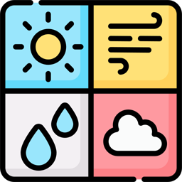

<h1>
  
  Local Meteo
</h1>

**Local Meteo** è un'integrazione per **Home Assistant** che raccoglie dati meteo in tempo reale da diverse fonti e li rende disponibili come sensori unici. L'integrazione è progettata per l'Italia, con aggiornamento rapido e sensori affidabili.

---

## ⚡ Fonti dati e crediti

| Parametro | Fonte principale | Fallback |
|-----------|-----------------|----------|
| Pioggia istantanea | [Open-Meteo](https://open-meteo.com/) (minutely 15 min) | — |
| Pioggia accumulata | [ARPAV](http://www.arpa.veneto.it) (stazione più vicina) | Open-Meteo |
| Temperatura | ARPAV | Open-Meteo |
| Umidità | ARPAV | Open-Meteo |
| Vento | ARPAV | Open-Meteo |
| Temperatura percepita | Open-Meteo | — |
| Punto di rugiada | Open-Meteo | — |
| Pressione | Open-Meteo | — |
| Raffiche vento | Open-Meteo | — |
| Indice UV | Open-Meteo | — |
| Visibilità | Open-Meteo | — |
| Copertura nuvolosa | Open-Meteo | — |
| Condizione cielo | `_compute_sky()` → combina pioggia + cloudcover | — |

> **Nota:** temperatura, vento e umidità sono **dati locali** presi dalla stazione ARPAV più vicina. Gli altri parametri provengono da Open-Meteo, gratuito e senza API key.
>
> **Copertura ARPAV:** ARPAV è l'agenzia regionale del **Veneto**, quindi i dati delle stazioni sono significativi per località in Veneto o vicine. Per le altre zone i valori provengono principalmente da Open-Meteo.

### 🙏 Crediti

- **Dati meteo e ricerca località**: [Open-Meteo.com](https://open-meteo.com/),
  licenza [CC BY 4.0](https://creativecommons.org/licenses/by/4.0/).
  *Weather data by [Open-Meteo.com](https://open-meteo.com/).*
- **Dati delle stazioni meteo**: ARPAV – Agenzia Regionale per la Prevenzione e
  Protezione Ambientale del Veneto ([www.arpa.veneto.it](http://www.arpa.veneto.it)).

Questo progetto non è affiliato, approvato o sponsorizzato da Open-Meteo né da ARPAV.
I dati sono forniti "così come sono", senza garanzie su accuratezza o disponibilità.


## 🛠️ Sensori disponibili
| Sensore | Unità | Descrizione |
|---------|-------|-------------|
| Temperatura | °C | Temperatura attuale dalla stazione ARPAV più vicina |
| Umidità | % | Umidità relativa dalla stazione ARPAV più vicina |
| Temperatura percepita | °C | Temperatura percepita (windchill/heat index) |
| Punto di rugiada | °C | Temperatura di rugiada |
| Pressione | hPa | Pressione atmosferica al livello del mare |
| Velocità vento | km/h | Vento dalla stazione ARPAV più vicina |
| Direzione vento | ° | Direzione del vento |
| Raffiche vento | km/h | Velocità massima delle raffiche |
| Pioggia | mm | Pioggia accumulata dalla stazione ARPAV più vicina |
| Pioggia istantanea | mm/h | Intensità pioggia aggiornata ogni 15 minuti |
| Indice UV | UV | Indice di radiazione ultravioletta |
| Visibilità | m | Visibilità in metri |
| Copertura nuvolosa | % | Percentuale di copertura nuvolosa |
| Condizione cielo | — | Calcolata combinando pioggia e copertura nuvolosa |

---

## ⚙️ Configurazione

1. Vai in **Home Assistant > Impostazioni > Dispositivi e Servizi > Aggiungi integrazione**
2. Cerca `Local Meteo`
3. Nella finestra di configurazione hai due possibilità:
   * **Posizione di Home Assistant (predefinita)**: lascia il campo *Città / Paese* vuoto e conferma. Latitudine e longitudine vengono lette automaticamente dalla posizione di casa impostata in Home Assistant (la finestra te ne mostra i valori).
   * **Un'altra località**: scrivi il nome della città o del paese. Latitudine e longitudine vengono calcolate in automatico tramite la [Geocoding API di Open-Meteo](https://open-meteo.com/en/docs/geocoding-api).
4. Se esistono più località con lo stesso nome (ad esempio "San Martino"), ti viene chiesto di scegliere quella corretta da un elenco con comune, provincia e regione.

### Cambiare località

Dopo l'installazione puoi cambiarla da **Impostazioni > Dispositivi e Servizi > Local Meteo > Configura**: inserisci una nuova città, oppure lascia il campo vuoto per tornare alla posizione di casa di Home Assistant. L'integrazione si ricarica da sola.

> **Nota:** la posizione di Home Assistant viene letta al momento del salvataggio della configurazione. Se in seguito la modifichi in Home Assistant, apri **Configura**, lascia il campo vuoto e conferma per aggiornare l'integrazione.
---

## ⏱️ Aggiornamento dati
- Tutti i sensori si aggiornano ogni **5 minuti**
- La pioggia istantanea usa i dati **minutely 15** di Open-Meteo (aggiornamento ogni 15 minuti)
- Temperatura, vento e umidità vengono sempre letti dalla **stazione ARPAV più vicina**, con fallback automatico su Open-Meteo in caso di errore

---

## 📂 Struttura repository
```
custom_components/
└── local_meteo/
    ├── icons/
    │   └── icon.png
    ├── __init__.py
    ├── manifest.json
    ├── config_flow.py
    ├── coordinator.py
    ├── const.py
    └── sensor.py
```
